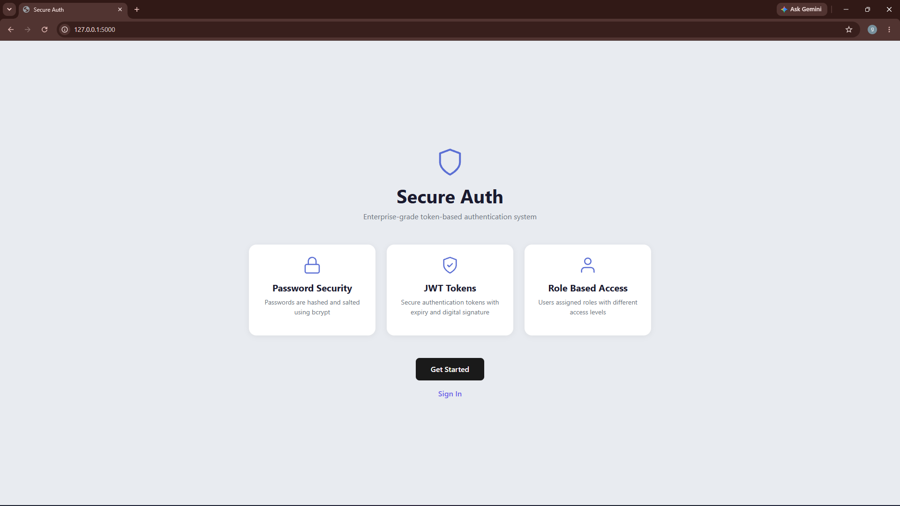
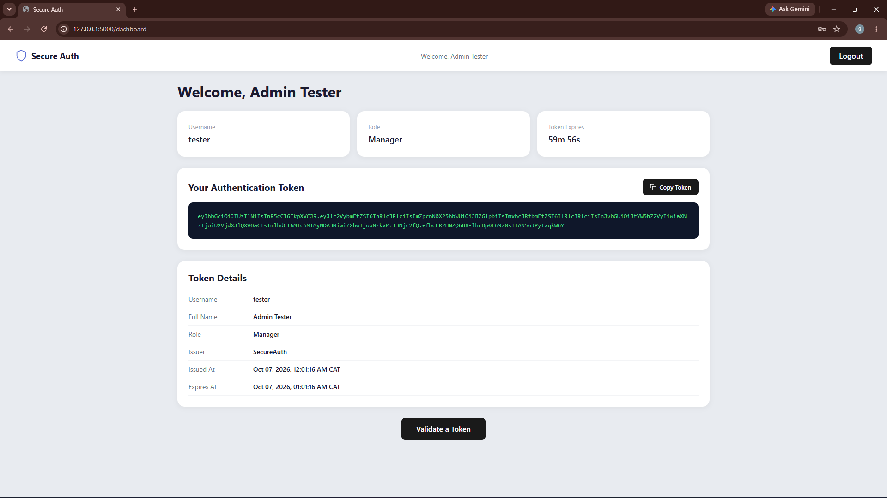

# Secure Auth: Token-Based Authentication System

A web-based authentication system built with Python and Flask. Users can register, log in and receive a signed JWT. Anyone can check a token's validity on the public token validator page.

Built as a university project for an Advanced Cyber Security module.

## Features

- User registration with first name, last name, username, password and role (`staff` or `manager`)
- Password strength validation (uppercase, lowercase, numbers and special characters)
- Passwords hashed and salted with bcrypt
- JWT generation on login, containing:
  - Username and full name
  - Role / permissions
  - Issuer
  - Issued-at and expiry timestamps (1 hour)
  - Digital signature (HMAC-SHA256)
- Public token validator page
- Automatic logout when the token expires
- Role-based access control (`staff`, `manager` and `admin`)

## Security Measures

- bcrypt password hashing with automatic salting
- Parameterised SQL queries, plus input sanitisation on user inputs
- JWTs signed with HMAC-SHA256 and a short 1-hour expiry
- Generic login error messages to prevent username enumeration
- Secrets loaded from environment variables, never committed to the repository

## Tech Stack

- Python 3, Flask
- bcrypt, PyJWT, pytz, python-dotenv
- SQLite
- Bootstrap 5, HTML, CSS, JavaScript

## Project Structure

```
├── app.py              # Flask app, routes and database setup
├── requirements.txt    # Python dependencies
├── .env.example        # Template for environment variables
├── templates/
│   ├── base.html       # Base template
│   ├── index.html      # Landing page
│   ├── login.html      # Login page
│   ├── register.html   # Registration page
│   ├── dashboard.html  # User dashboard
│   └── validate.html   # Token validator page
└── static/
    ├── style.css       # Stylesheet
    └── script.js       # JavaScript
```

## Getting Started

### 1. Clone the repository

```bash
git clone https://github.com/YOUR-USERNAME/REPO-NAME.git
cd REPO-NAME
```

### 2. Create and activate a virtual environment

```bash
python -m venv venv
venv\Scripts\activate        # Windows
source venv/bin/activate     # Mac/Linux
```

### 3. Install dependencies

```bash
pip install -r requirements.txt
```

### 4. Configure environment variables

```bash
copy .env.example .env       # Windows
cp .env.example .env         # Mac/Linux
```

Open `.env` and replace each `change-me` with your own value. Generate each key with:

```bash
python -c "import secrets; print(secrets.token_hex(32))"
```

| Variable           | Description                                                               |
| ------------------ | ------------------------------------------------------------------------- |
| `FLASK_SECRET_KEY` | Signs Flask session cookies                                               |
| `JWT_SECRET_KEY`   | Signs and verifies JWTs. Keep it private and different from the Flask key |
| `JWT_ISSUER`       | Issuer name embedded in tokens (defaults to `SecureAuth`)                 |
| `FLASK_DEBUG`      | `1` for development, `0` otherwise                                        |

### 5. Run the app

```bash
python app.py
```

The database is created automatically on first run. Open http://127.0.0.1:5000 and register an account.

## Roles

| Role      | Access                                                                                 |
| --------- | -------------------------------------------------------------------------------------- |
| `staff`   | Standard access. Selectable at registration                                            |
| `manager` | Elevated access. Selectable at registration                                            |
| `admin`   | Administrative access. Cannot be self-registered; provisioned directly in the database |

The role is validated server-side against a whitelist and embedded in the JWT as a claim.

## Design Documentation

Design decisions, security testing results (sqlmap, JWT.io, OWASP ZAP) and screenshots are in [docs/DESIGN.md](docs/DESIGN.md).

## Screenshots




## Author

Thabang Dube
BSc (Hons) Computer Systems Engineering

## License

["For academic purposes only"]
