# Secure Auth: Design and Security Evaluation

Design decisions and security testing for the Secure Auth token-based authentication system. For setup instructions, see the [main README](../README.md).

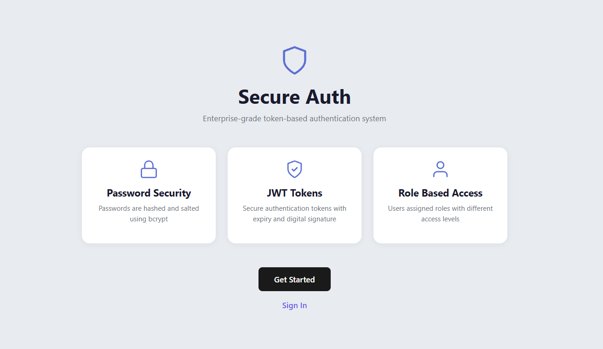

## Architecture

| Choice | Why |
|---|---|
| **Python** | Readable, with mature security libraries (bcrypt, PyJWT, Flask) |
| **Flask** | Lightweight and minimal, so each security decision is made explicitly rather than hidden in a framework |
| **SQLite** | Built into Python and needs no setup, which suits a prototype. Every query uses `?` placeholders, never string concatenation |

The user table stores first name, last name, username, hashed password and role.

## Security Design

### Password hashing (bcrypt)
Passwords are never stored in plain text. bcrypt adds a unique random salt per password, so identical passwords produce different hashes and rainbow-table attacks fail. Its configurable cost factor deliberately slows hashing to make brute force expensive. Login uses `bcrypt.checkpw()` to compare against the stored hash.

### Password strength validation
The server enforces a minimum of 8 characters with at least one uppercase letter, lowercase letter, number and special character. A JavaScript indicator on the registration page also shows Weak, Medium or Strong as the user types, listing any unmet criteria.

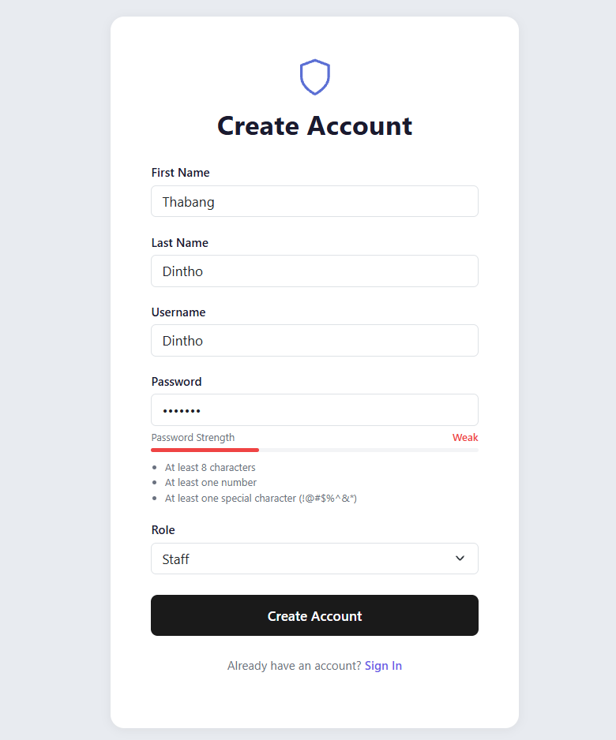

### Input sanitisation
A `sanitize_input()` function trims whitespace, rejects inputs over 50 characters and blocks dangerous characters (angle brackets, quotes, semicolons, parentheses). The role field is checked against a whitelist (`staff` and `manager` only), so a tampered request cannot inject a custom role. Sanitisation is a second layer; parameterised queries are the primary defence against SQL injection.

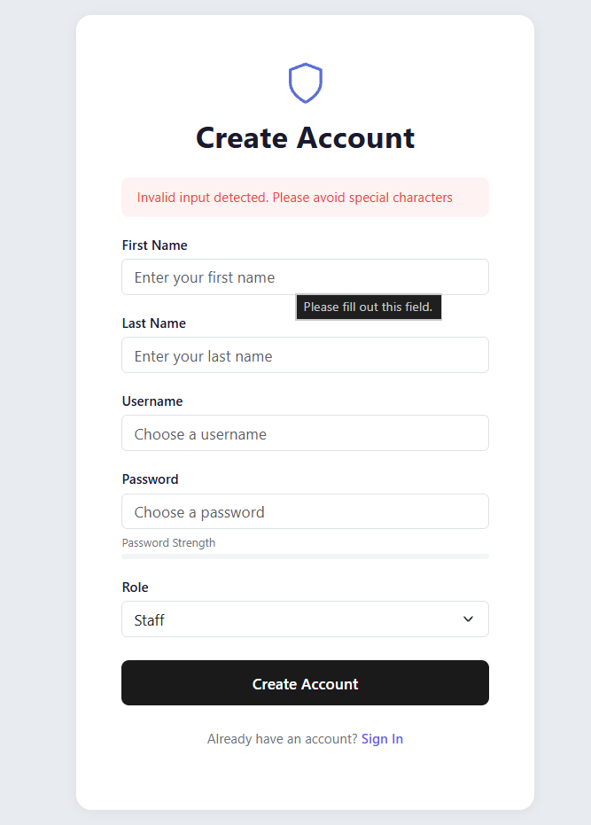

### JSON Web Tokens
On login, PyJWT issues a token signed with HMAC-SHA256 (HS256) containing:

- username, first name, last name and role
- issuer (`iss`), issued-at (`iat`) and expiry (`exp`)

The token never contains the password hash or other sensitive data. Without the secret key an attacker cannot forge a token, and changing any claim invalidates the signature, so a user cannot promote their own role.

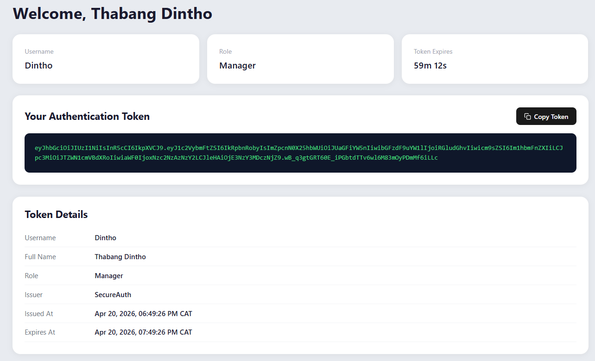

### Token expiry
Tokens expire after one hour, limiting the damage if one is stolen. The dashboard shows a live countdown, and the user is logged out when it reaches zero. Every login issues a fresh token.

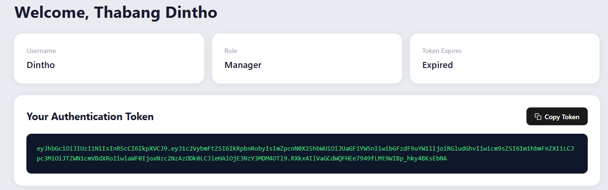

### Token validation
The validator page is public, as token validation endpoints are in systems like OAuth 2.0, so tokens can be checked independently of a login session. It handles four cases separately: expired, tampered, malformed and unexpected errors, so bad input never crashes the app.

| Valid | Expired | Invalid |
|---|---|---|
| 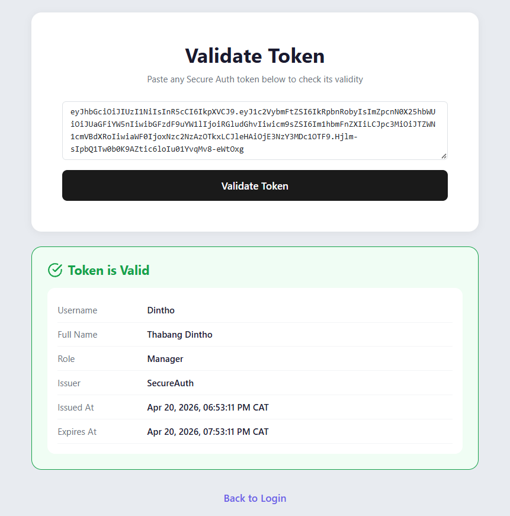 | 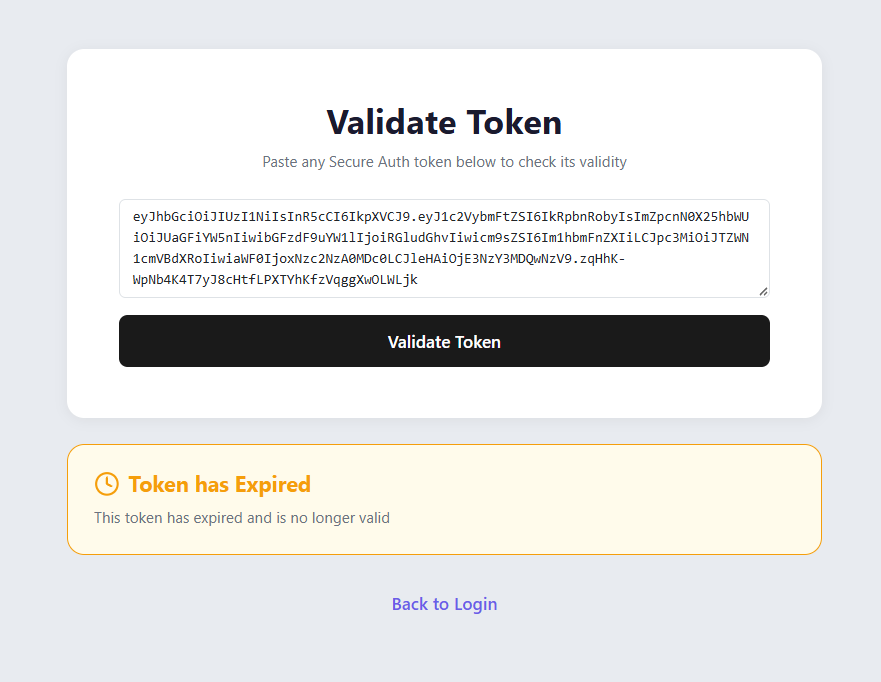 | 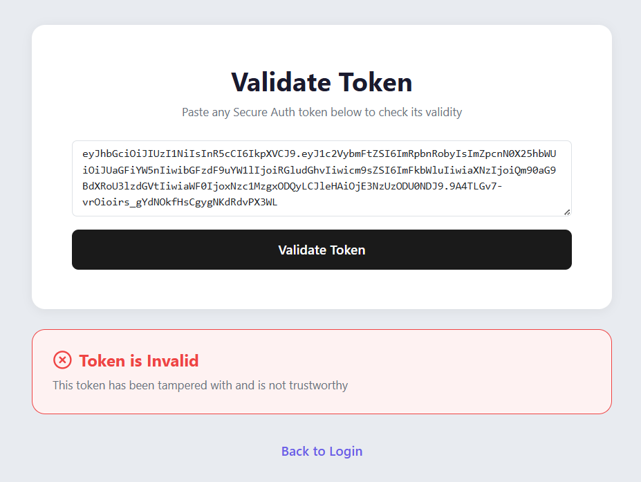 |

### Role-based access control
Users choose `staff` or `manager` at registration. The role travels inside the JWT, so other systems can read permissions from the token without a database lookup. The `admin` role cannot be self-registered and is provisioned directly in the database.

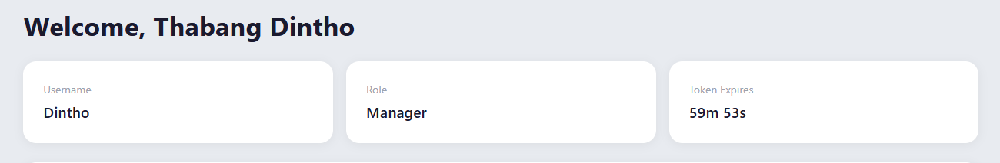

### Login errors and UI
The login page returns one generic message ("Invalid username or password") whichever field is wrong, which prevents username enumeration.

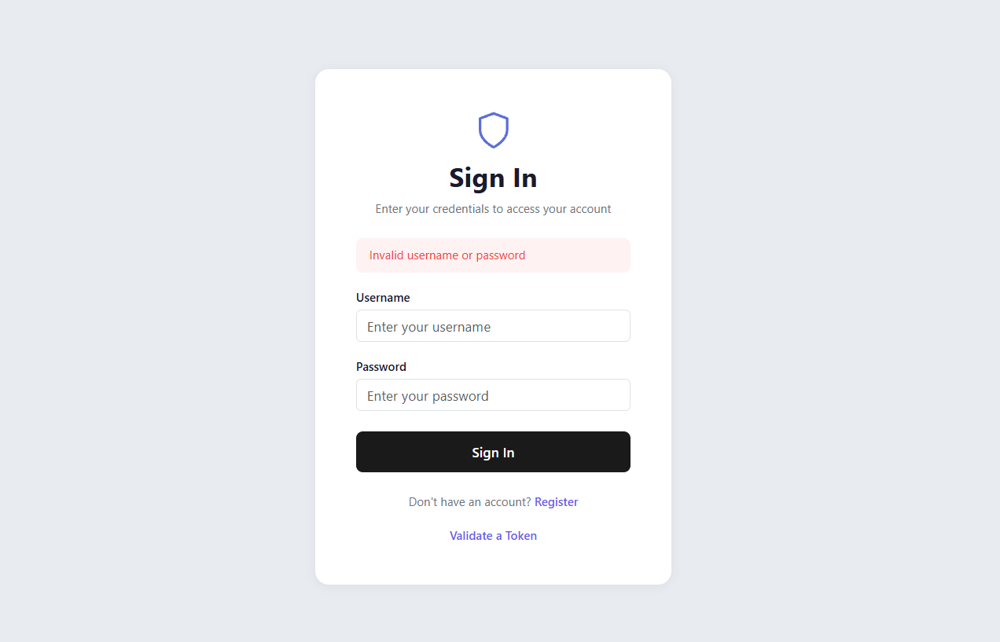
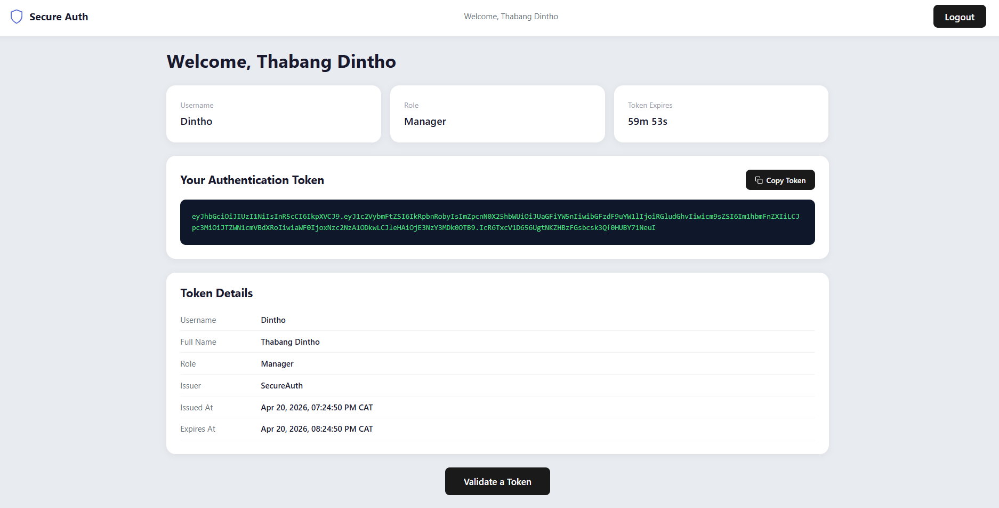

## Security Testing

### SQL injection (sqlmap)
sqlmap tested the `username` and `password` parameters of `/login` with boolean-based blind, error-based, time-based blind and UNION-based techniques. Both were reported as not injectable.

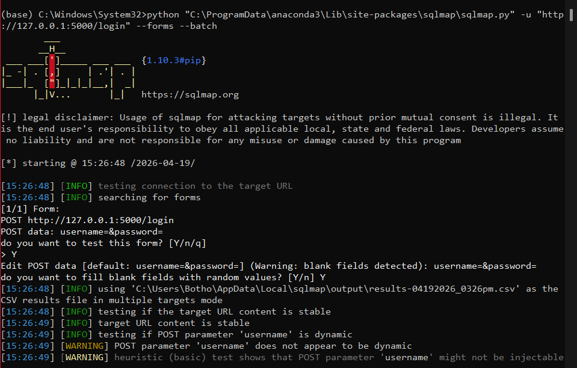
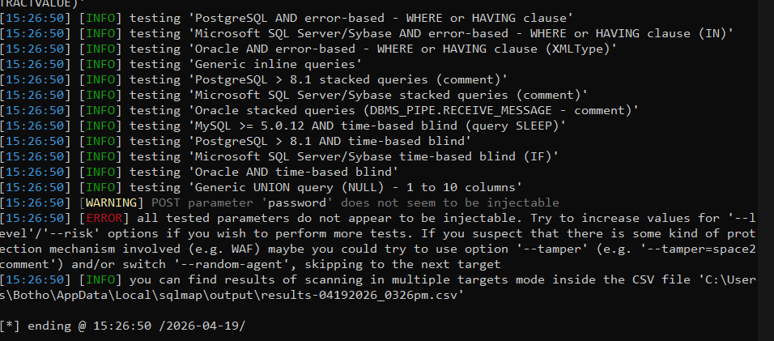

### Token integrity (JWT.io)
Pasting a generated token into the JWT.io debugger showed all claims decoded correctly. Signature verification failed with an incorrect secret, confirming the token can't be verified or altered without the application's secret key. (The token shown has long since expired.)

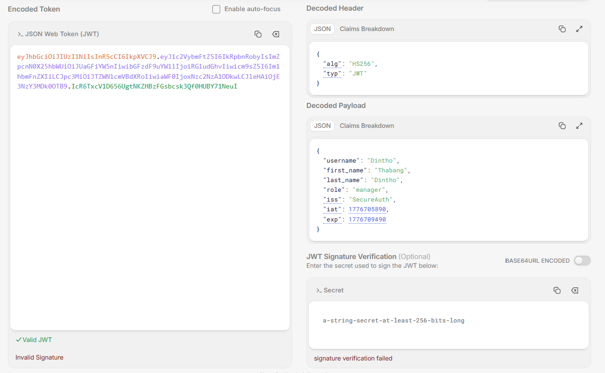

### Vulnerability scan (OWASP ZAP)
ZAP reported nine alerts and no high-risk findings. The most significant was **missing anti-CSRF tokens** on the login, register and validate forms (Medium risk, low confidence, CWE-352).

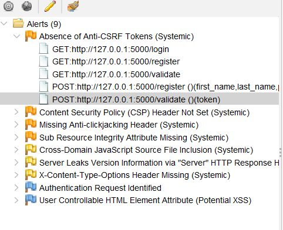
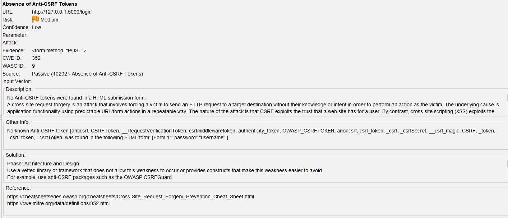

## Known Limitations and Future Work

- **CSRF protection:** add Flask-WTF so every form carries a CSRF token
- **Rate limiting** on login attempts to slow brute-force attacks
- **Refresh tokens** for longer sessions without long-lived access tokens
- **Multi-factor authentication**
- **Security headers:** ZAP also flagged a missing Content Security Policy, anti-clickjacking and `X-Content-Type-Options` headers
